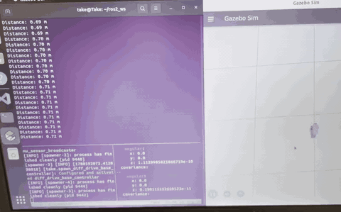
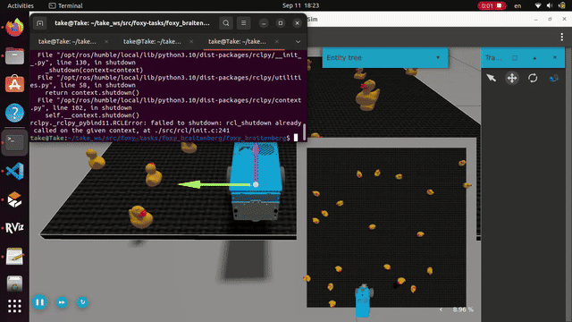

# ROS 2 Foxy Projects

A collection of ROS 2 exercises and small projects developed using the
Foxy Robot platform from EOLab, Hochschule Rhein-Waal.

## Projects

### Drive Square
A ROS 2 Python controller that makes Foxy drive a 1 m × 1 m square in Gazebo.

- Uses `geometry_msgs/msg/Twist` for velocity commands
- Uses odometry to measure travelled distance
- Uses yaw orientation for approximately 90° turns
- Uses Gazebo simulation time

Demo:

---

### Braitenberg Vehicles

ROS 2 controllers inspired by Braitenberg Vehicles, using camera and color filtering to generate simple reactive behaviors.

#### Vehicle 2a

Vehicle 2a uses direct sensor-to-motor connections.

- Left sensor influences the left wheel
- Right sensor influences the right wheel
- Uses camera-based color detection
- Uses left/right image occupancy values as sensor inputs
- Publishes 'geometry_msgs/msg/Twist' velocity commands

### Demo

--- 

#### Vehicle 2b

Vehicle 2b uses crossed sensor-to-motor connections.

- Left sensor influences the right wheel
- Right sensor influences the left wheel
- Uses camera-besed color detection
- Uses left/right image occupancy values as sensor inputs
- Publishes 'geometry_msgs/msg/Twist' velocity commands

### Demo

---

### Braitenberg Data Flow

Camera  
↓  
Color Filter  
↓  
Left / Right Occupancy  
↓  
Braitenberg Controller  
↓  
Twist Velocity Command  
↓  
Foxy Robot

## Technologies

- ROS2 Humble
- Python
- rclpy
- Gazebo
- RViz
- OpenCV
- ROS 2 Topics
- Publisher / Subscriber commnucation

## Resources

- Foxy Robot repository: https://github.com/EOLab-HSRW/foxy-robot
- Foxy documentation: https://eolab-hsrw.github.io/foxy-docs/
- Drive Square exercise: https://eolab-hsrw.github.io/foxy-docs/docs/exercises/square
